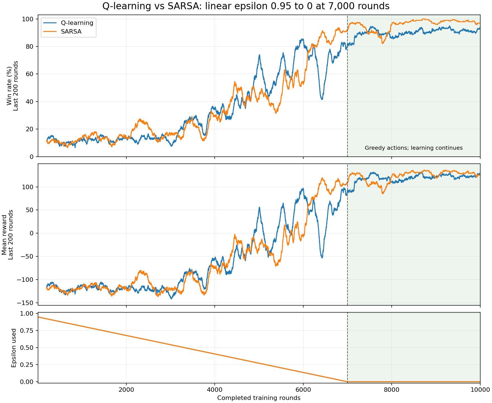
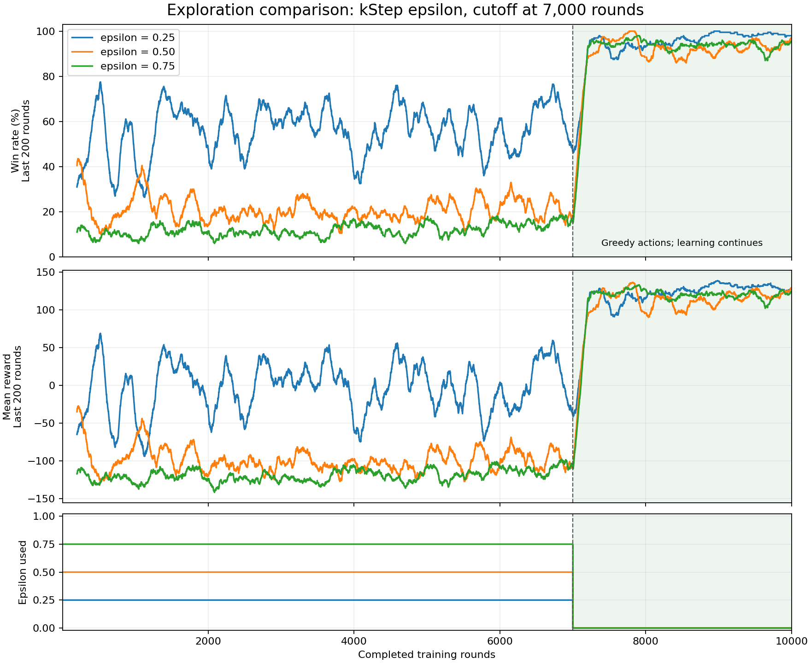
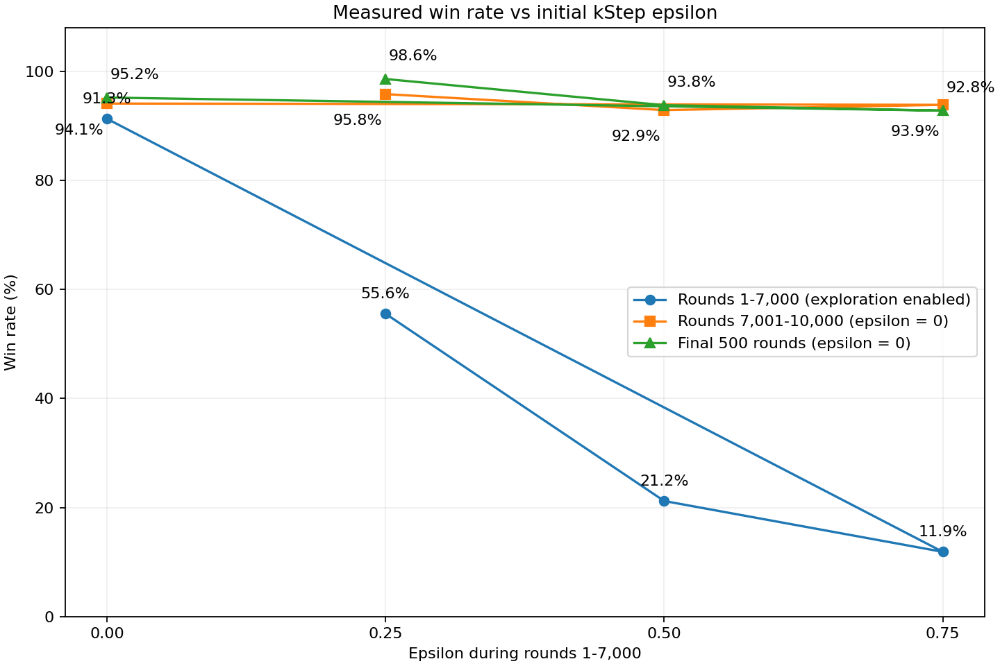

# CapPeeler Q-learning

## Diagnosing stalled battles

Checkpoint replacement retries transient Windows `PermissionError` failures up
to five attempts with a total maximum retry delay of 0.75 seconds. Persistent
save errors are recorded with a traceback in the diagnostic log. The prior
checkpoint and completed `.npz.tmp` are preserved on replacement failure. An
orphaned temporary checkpoint can also mean the process was stopped during a
save; it is evidence of an interrupted save, not proof of a Windows file lock.
The watchdog remains active while waiting for round end after death, so those
stalls can also produce a thread snapshot.

CapPeeler records lifecycle information in `training/sarsa/cappeeler.diagnostics.log`
(beside a custom table when configured). If active tick progress stops for 20
seconds, a background watchdog writes all Python thread stacks once for that
stall. It does no disk I/O on the normal per-tick path. An intentional pause
can also trigger this diagnostic; it is evidence to inspect, not a diagnosis.
Restart the bot after code changes. `diagnostics_enabled=False` disables the watchdog.
The plot subprocess has separate input/output handles and sends errors to
`training/sarsa/cappeeler.plot.log`, so an open plot cannot retain the booter's pipes.
No automatic process restarts or battle-rule changes are made.

## Epsilon schedules with an exact cutoff

Configure the LUT after loading any saved table:

```python
from LUTInterface import EpsilonSchedule

lut.configure_epsilon(start=0.8, zero_at_battle=7000, mode=EpsilonSchedule.Decay.kLinear)
# Or: mode=EpsilonSchedule.Decay.kStep to hold 0.8 through battle 6999, then use 0 at 7000.
```

Battle indices are zero-based. The saved `episodes` count is the index of the
next training round: a new table starts at battle 0. Linear decay uses
`max(0, start * (1 - battle / zero_at_battle))`. At battle 3500 epsilon is 0.4;
at 6999 it is approximately 0.0001143; at 7000 and later it is exactly zero.
A cutoff of zero disables exploration immediately. These schedules have no
0.05 floor. They control exploration; learning continues after epsilon is zero.
The schedule and progress are saved by `saveWeights` and restored by `loadWeights`.
`configure_epsilon` immediately applies the schedule at the current episode count.
Increment `lut.episodes` after each training round, then call `lut.decay_epsilon()`;
CapPeeler already does this. Evaluation does not advance the schedule.

Configure CapPeeler directly in its `main()` function. `Algorithm` and
`RewardMode` are enums nested inside `LUTInterface` (imported from `LUTInterface`):

```python
CapPeeler(epsilon_start=0.8, epsilon_zero_at_battle=7000,
          epsilon_decay=EpsilonSchedule.Decay.kStep,
          algorithm=LUTInterface.Algorithm.kSarsa,
          reward_mode=LUTInterface.RewardMode.kTerminal).start()
```

All robot settings are supplied as arguments to `CapPeeler(...)` in `main()`:

| Parameter | Purpose |
| --- | --- |
| `epsilon_start` | Initial exploration probability; use 0 for no exploration |
| `epsilon_zero_at_battle` | Round cutoff for exploration; 0 disables it immediately |
| `epsilon_decay` | `EpsilonSchedule.Decay.kLinear` or `.kStep` |
| `algorithm` | `LUTInterface.Algorithm.kQLearning` or `.kSarsa` |
| `reward_mode` | `LUTInterface.RewardMode.kIntermediate` or `.kTerminal` |
| `training` | `True` to learn and save; `False` for greedy evaluation |
| `table_path` | Checkpoint filename; CSV and diagnostic logs use the same stem |
| `seed` | Optional integer seed for action selection |
| `diagnostics_enabled` | Enable or disable the watchdog |

Without an explicit cutoff, a saved schedule resumes automatically. A fresh
LUT without a schedule holds `epsilon_start` constant, including zero.
Existing
tables past episode 7000 immediately use zero when configured with that cutoff.
Use a new table path to start at battle 0. The CSV still records epsilon after
each completed round (the value for the next battle), with one-based episode
numbers, so its row for episode 7000 records epsilon 0.

## Question (2)

> Please provide a description of your LUT in terms of the states and actions you chose to use, how or if they were quantized and the resulting total number of rows in the LUT.

**Answer.**

The observation is quantized only when indexing the table:

| State variable | Quantization | Bins |
| --- | --- | --- |
| Enemy distance | [0,150), [150,400), [400,infinity) | 3 |
| Relative bearing | front [-45,45), right [-135,-45), back [-180,-135) or [135,180), left [45,135) degrees | 4 |
| Own energy | [0,30), [30,70), [70,infinity) | 3 |
| Enemy energy | [0,30), [30,70), [70,infinity) | 3 |

Bearings are normalized to [-180,180). There are 3*4*3*3 = **108 states**.
The six discrete actions are forward, backward, left, right, fire, and face enemy.
They are held for five ticks; radar scanning and gun aiming run independently.
Thus the state-row representation has **108 rows and 6 action columns**. If each
row represents a complete state-action pair, there are **648 rows/Q-values**.
The actual NumPy array has shape (3,4,3,3,6). Actions are a predefined discrete
set, rather than a quantization of all possible continuous control combinations.

Update frequencies are tracked separately from Q-values:

- `lut.update_counts` has the same shape as `lut.Q` and counts updates per
  state-action pair. It increments on each successful Q-learning or SARSA update,
  including terminal updates and updates with zero TD error. Choosing an action
  or evaluating without learning does not increment it.
- `lut.state_update_counts` sums across actions, giving total updates per state
  row with shape (3,4,3,3).
- `saveWeights` persists `update_counts` in the `.npz` file; `loadWeights` restores
  it. Older files still load, but counts start at zero: historical update counts
  cannot be recovered from their Q-values or the per-round CSV. Thus zero counts
  in resumed old tables mean no updates recorded since tracking was introduced.

For later neural-network training, filter a separate dataset rather than deleting
entries from the live LUT (all state indices must remain valid). For example:

```python
mask = lut.update_counts >= 20  # Example threshold, chosen for your dataset.
inputs = np.argwhere(mask)     # Columns: four state-bin indices, action index.
targets = lut.Q[mask]          # Corresponding scalar Q-value targets.
counts = lut.update_counts[mask]
```

For a network predicting all six actions per state, `lut.state_update_counts`
filters total state coverage, but does not guarantee every action was learned.
Use `(lut.update_counts >= 20).all(axis=-1)` if all six targets must meet the
threshold. These are discrete bin indices, not raw physical measurements.

## Question (3)

> Once you have your robot working, measure its learning performance as follows:

### (3a)

> Draw a graph of a parameter that reflects a measure of progress of learning and comment on the convergence of learning of your robot.

**Answer.** I measured progress using win rate and average episode reward over a
rolling window of 200 completed rounds. Win rate is the number of wins divided
by the number of rounds in that window. Each run contains 10,000 consecutive
rounds, and the first plotted point uses a complete 200-round window.

The Q-learning and SARSA runs both use a linear epsilon schedule starting at
0.95 and reaching zero after 7,000 rounds. The final 3,000 rounds use greedy
actions, with learning still enabled. The shaded region in Figure 1 identifies
this phase. The epsilon panel shows the probability used during each round,
reconstructed from the saved schedule. The CSV itself records epsilon after
the round, which is the probability for the following round.



*Figure 1. Rolling win rate and average reward, with the shared exploration
schedule. Sources: [Q-learning data](../../training/qlearning/cappeeler.csv) and
[SARSA data](../../training/sarsa/cappeeler.csv), with their saved checkpoint schedules.*

| Algorithm | First 500 win rate | Final 500 win rate | First 500 mean reward | Final 500 mean reward |
| --- | ---: | ---: | ---: | ---: |
| Q-learning | 11.0% | 92.0% | -117.50 | 124.30 |
| SARSA | 11.0% | 97.8% | -118.64 | 128.37 |

Both runs improve substantially. Late performance is comparatively stable:
Q-learning records 92.4% wins in rounds 9,001-9,500 and 92.0% in rounds
9,501-10,000; SARSA records 98.8% and 97.8%, respectively. This supports a
practical plateau in measured performance. It does not prove that every LUT
entry has converged. The learning rate remains 0.1, and the improvement while
epsilon falls includes the effect of taking fewer random actions. No history
of Q-value changes was logged to establish numerical convergence directly.

### (3b)

> Using your robot, show a graph comparing the performance of your robot using on-policy learning vs off-policy learning.

**Answer.** Figure 1 compares off-policy Q-learning against on-policy SARSA.
Q-learning uses the largest next-state Q-value in its update:

`Q(s,a) <- Q(s,a) + alpha * [r + gamma * max_b Q(s',b) - Q(s,a)]`.

SARSA uses the Q-value of the action actually selected by its epsilon-greedy
policy and executed next:

`Q(s,a) <- Q(s,a) + alpha * [r + gamma * Q(s',a') - Q(s,a)]`.

Both use reward alone for terminal updates. The current implementation uses
alpha = 0.1 and gamma = 0.95. The recorded epsilon schedules and round budgets
match between these two runs.

| Algorithm | Win rate, rounds 1-7,000 | Win rate, rounds 7,001-10,000 | Final 500 win rate | Final 500 mean reward | Final 500 mean duration (turns) |
| --- | ---: | ---: | ---: | ---: | ---: |
| Q-learning | 34.26% | 90.67% | 92.0% | 124.30 | 181.79 |
| SARSA | 34.63% | 96.07% | 97.8% | 128.37 | 206.84 |

During the first 7,000 rounds the aggregate win rates are similar. After
exploration ends, SARSA has the higher win rate in this pair of runs. In the
final 500 rounds its advantage is 5.8 percentage points, with slightly higher
mean reward. Its rounds also last about 25 turns longer on average. Duration
alone does not establish a particular movement or firing strategy.

These are results from one run per condition. Algorithm labels come from the
respective experiment folders as identified by the user; the CSV and checkpoint
do not store the algorithm, reward mode, opponent, arena settings, or random
seed. Repeated matched runs would be needed to establish a general algorithm
advantage. Once epsilon is zero, SARSA selects a maximizing action, so its
bootstrap target matches Q-learning for the same transition. Different learned
tables and subsequent trajectories can still produce different results.

### (3c)

> Implement a version of your robot that assumes only terminal rewards and show & compare its behaviour with one having intermediate rewards.

**Answer.** The robot implements both reward modes:

| Event | Intermediate-reward mode | Terminal-only mode |
| --- | ---: | ---: |
| Bullet hits an opponent | +10 | 0 |
| Hit by a bullet | -10 | 0 |
| Wall collision | -5 | 0 |
| Robot collision | -3 | 0 |
| Win | +100 | +100 |
| Death | -100 | -100 |
| Draw terminal bonus | 0 | 0 |

Set `reward_mode=LUTInterface.RewardMode.kTerminal` in `main()` to enable
terminal-only rewards. Intermediate
transitions still perform TD updates, with zero immediate reward in that mode.
Terminal rewards can therefore propagate back through earlier transitions.

**Measured comparison pending:** the provided folders do not identify a
terminal-only experiment. A terminal-only run and a matching intermediate-reward
run are needed before a behaviour comparison or supporting graph can be given.
Use win rate as the common metric because raw reward totals have different
meanings under the two reward definitions. Less frequent feedback may slow
learning, but that is an expectation to test, not a measured result here.

## Question (4)

> This part is about exploration. While training via RL, the next move is selected randomly with probability epsilon and greedily with probability 1 - epsilon.

### (4a)

> Compare training performance using different values of epsilon including no exploration at all. Provide graphs of the measured performance of your tank vs epsilon.

**Answer.** I compared the completed kStep runs with initial epsilon values
0.25, 0.50, and 0.75. Each keeps epsilon constant for rounds 1-7,000 and then
sets it to zero for rounds 7,001-10,000. The 0.8 experiment is excluded.
Figures 2 and 3 show the measured learning curves and win rate versus the initial
exploration probability.



*Figure 2. Rolling 200-round win rate and mean reward, with epsilon used in each
round. The shaded phase uses epsilon = 0 while learning continues.*



*Figure 3. Win rate at each initial epsilon, reported separately for rounds
1-7,000, rounds 7,001-10,000, and the final 500 rounds. Lines connect the three
measured settings only; no unmeasured setting is estimated.*

| Initial epsilon | Win rate, rounds 1-7,000 | Mean reward, rounds 1-7,000 | Win rate, rounds 7,001-10,000 | Final 500 win rate | Final 500 mean reward |
| --- | ---: | ---: | ---: | ---: | ---: |
| 0.25 | 55.56% | -4.91 | 95.83% | 98.6% | 129.78 |
| 0.50 | 21.21% | -98.43 | 92.90% | 93.8% | 121.32 |
| 0.75 | 11.89% | -119.32 | 93.87% | 92.8% | 118.26 |
| 0 from initialization | Pending | Pending | Not applicable | Pending | Pending |

Sources: [epsilon 0.25 data](../../training/0.25%20epsilon/cappeeler.csv),
[epsilon 0.50 data](../../training/0.5%20epsilon/cappeeler.csv), and
[epsilon 0.75 data](../../training/0.75%20epsilon/cappeeler.csv), with the Step schedules
verified against the checkpoint files. The algorithm and reward mode of these
runs are not recorded in those files, so the comparison assumes those settings
were held constant across the three experiments.

Among the tested values, epsilon = 0.25 achieves the highest win rate during
exploration and in the final 500 rounds. Increasing epsilon reduces performance
while exploration is active, consistent with a larger fraction of random actions
interrupting useful behaviour. All three runs improve sharply when epsilon
becomes zero, indicating that their exploratory battle performance understates
the performance available with greedy action selection. Learning continues, so
the later phase is not a frozen-policy evaluation.

The final ordering is not strictly monotonic across every measurement window:
epsilon = 0.75 slightly exceeds 0.50 over the full final 3,000 rounds, but scores
below it over the final 500. These single runs support choosing 0.25 among the
three tested settings; they do not establish an optimal epsilon in general.

**No-exploration baseline pending:** the user is training epsilon = 0 from
initialization. Switching exploration off after 7,000 exploratory rounds is not
that baseline. Its data and plot will be added when the run completes. Greedy
action ties may still be resolved randomly even when explicit exploration is zero.

### Evidence and reproduction

The plotted results use 50,000 completed rounds across the five included runs.
All histories are continuous from episode 1 through 10,000. Saved epsilon
schedules were checked against every CSV row. Figures use full rolling windows;
summary tables use the exact episode ranges shown, with wins divided by all
rounds, including any draws. There is one run per condition and no estimate of
variation across independent seeds.

Regenerate the three figures and exact numeric summaries from the repository
root with:

```powershell
.venv/Scripts/python.exe -B src/analyze_experiments.py
```

The figures are saved under `doc/Part 2/figures/`; exact unrounded summary
values are in `doc/Part 2/figures/measured_summary.json`. Original CSVs,
checkpoints, and per-run plots are preserved.

## Running and plotting the robot

After the configured rounds finish, a plot window opens automatically with
round reward, average reward and win rate over the last 50 rounds, and epsilon
against completed training rounds. Early averages use the available rounds.
The figure includes the full saved training history and is also saved as
`training/cappeeler-new.png` (or beside your custom CSV). These are training results
including exploration, rather than separate zero-epsilon evaluation results.
The epsilon curve shows the recorded value after each round.

To view the plot later without running a battle, use this command from the
repository root:

    .venv/Scripts/python.exe src/plot_learning.py --show

Use `--window 100` to change the averaging window, or pass a custom CSV filename.
`LUTInterface.plotLearningPerformance(filename, window=50, show=False)` saves the
figure and returns `(figure, axes)` for use from Python. The bot launches the
viewer in a separate process at game end so the plot does not block bot events.

CapPeeler trains automatically while fighting. Add `src/bots` as a bot directory
in Tank Royale, select CapPeeler and an opponent (start with Tracker), and run a
battle with many rounds. Install the root requirements into `.venv` first; the
bot launchers use that environment. Each round is one episode. No separate battle
controller is required: choose the round count in the GUI.

The algorithm follows the Q-learning algorithm discussed in the lecture notes:

    Q(s,a) += alpha * (reward + gamma * max(Q(next_state)) - Q(s,a))

Terminal transitions use reward alone. The LUT defaults to alpha=0.1 and
gamma=0.95. The current bot launcher selects SARSA with intermediate rewards
and a linear epsilon schedule starting at 0.95 and reaching zero after 7,000
rounds; constructor arguments in `main()` control these settings.
Greedy action selection breaks ties randomly.

`src/LUTInterface.py` implements Q-learning, the `State` dataclass, six actions,
and the abstract `BaseInterface` methods `saveWeights` and `loadWeights`. These
persist Q-values, epsilon and episode count in the existing `.npz` format.
`bots/CapPeeler/CapPeeler.py` is my robot.
`State` stores raw distance, bearing and energies as an immutable observation.
Its `distance_bin`, `bearing_bin`, `own_energy_bin`, and `enemy_energy_bin`
properties discretize those measurements. The LUT uses `state.to_tuple()` only
when indexing the NumPy table; action selection and updates accept `State` objects.
The existing neural-network interfaces from assignment #1 are independent and unchanged.

State order: distance, bearing, own energy, enemy energy (3 x 4 x 3 x 3).
Distance bins are [0,150), [150,400), [400,inf). Energy bins are [0,30), [30,70), [70,inf).
Bearing bins are front [-45,45), right [-135,-45), left [45,135), and back.
Positive bearings are ccw. There are 648 Q-values.
These numerical thresholds are starting choices; The hope is to optimize these.

Actions last five game ticks: forward (+8 speed), backward (-8), left (+10
degrees/tick), right (-10), fire (power 3 when aimed within 10 degrees and energy >=3), 
or face enemy. Radar scans continuously and the gun aims independently.
Actions use nonblocking commands; callbacks never call blocking movement methods.
Tick decisions run after scan and reward callbacks. The latest scanned enemy
position is used between scans; after 30 ticks aim/fire stop and any new target
can be acquired. This initial state space has no explicit unknown-target state.

Rewards: 
- bullet hit +10
- hit by bullet -10
- wall -5
- bot collision -3
- win +100
- death -100

A surviving round without a win/death event is a draw with
no terminal bonus. Rewards accumulate when events arrive, including delayed
bullet hits; they update the active transition, without retroactive bullet credit
assignment or extra energy shaping. Terminal callbacks collect rewards; after final events are flushed, the next round start or game end
performs one final update, including rounds shorter than five ticks.

Training outputs (saved at the next round start or game end):

- `training/sarsa/cappeeler.npz`: Q-values, epsilon and completed episode count;
  loaded automatically on the next launch.
- `training/sarsa/cappeeler.csv`: episode reward, outcome, turns, action count and
  epsilon. Compute win rate and average reward across a window of these rows.

To evaluate, set `training=False` in the `CapPeeler(...)` call in `main()`.
Evaluation chooses greedy actions and does not update Q-values, advance the
epsilon schedule, or write training files. Training is enabled by default.
Set `table_path` to choose a checkpoint; the CSV uses the same filename stem.
Use a new filename to start fresh. Run one training CapPeeler process per table
path to avoid concurrent writes. `seed` controls action selection randomness.

Run the focused checks from the repository root:

    .venv/Scripts/python.exe -B -m unittest discover -s test -v
